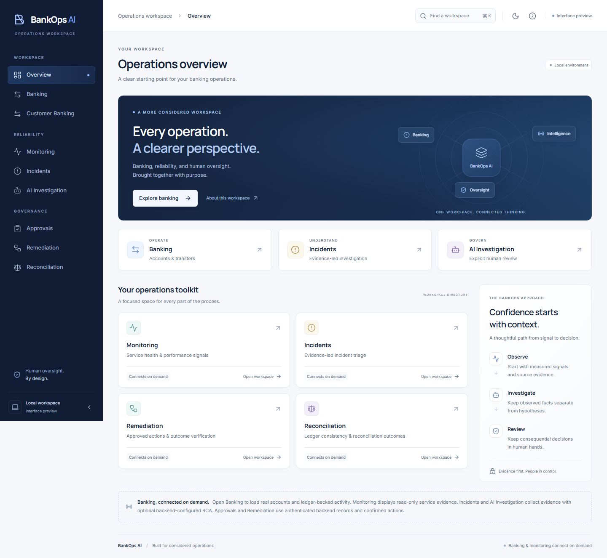
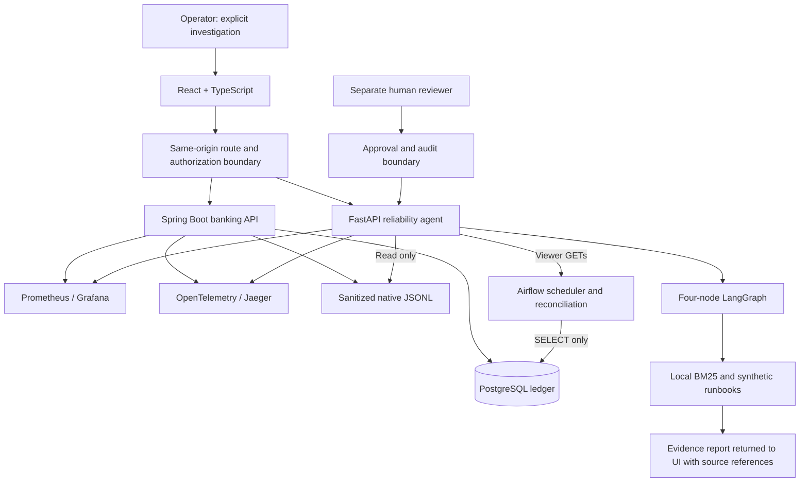

# BankOps AI

**Banking integrity, observability and evidence-grounded incident investigation.**

BankOps AI is a portfolio demonstration that combines a Java banking service,
read-only reconciliation, an observable Python reliability agent and a React
operations workspace. It demonstrates how to investigate an incident while
keeping financial writes, evidence collection and human authorization separate.

> **Portfolio demo, not a production banking system.** Investigation initiation
> is manual. Cloud LLM inference was tested using mocked transports; successful
> real cloud inference is not claimed. Inference and remediation are disabled by
> default, and operational banking evidence cannot be exported to cloud providers.



*Static workspace preview from a browser test that makes no service requests.
No account/customer data is shown. This image is not evidence of a live incident.*

## What this project demonstrates

- **Financial correctness:** transactional transfers, double-entry ledger
  invariants, rollback, idempotency, concurrency and database authorization tests.
- **Observability:** Prometheus metrics, Grafana dashboards, OpenTelemetry/Jaeger
  traces and bounded, sanitized native log evidence.
- **Real orchestration:** four LangGraph nodes collect/detect, assemble evidence
  and run optional analysis. Failed providers do not erase the deterministic report.
- **Lightweight RAG:** bounded document ingestion, overlapping chunks, an inverted
  BM25 index, stable source references and reviewed synthetic runbooks. Generated
  hypotheses must cite both valid current observations and relevant retrieved IDs.
- **Airflow integration:** the actual scheduler executed the reconciliation DAG;
  a controlled read-permission fault reached the agent, RAG and desktop/mobile-sized
  Chromium dashboard through real APIs in a disposable Compose environment.
- **Human oversight:** distinct proposer/reviewer roles, explicit confirmations,
  audit records and disabled-by-default remediation. Model output cannot directly
  modify banking records.
- **Honest presentation:** reviewed citations are expandable; unknown sources and
  missing evidence are handled explicitly. Similarity is not proof of causality.

## Architecture



The provider adapter is a separate opt-in synthetic-only path. No diagram arrow
implies that operational financial evidence is sent to a cloud model. See
[architecture and trust boundaries](docs/ARCHITECTURE.md).

## Technology stack

| Area | Technologies |
| --- | --- |
| Banking | Java 21, Spring Boot, PostgreSQL, Flyway |
| Reliability | Python 3.12, FastAPI, LangGraph, Pydantic, httpx2 |
| Retrieval | Local BM25, JSON documents, content-addressed references |
| Workflows | Apache Airflow, read-only aggregate reconciliation |
| Dashboard | React, TypeScript, Vite, Playwright/Chromium |
| Observability | Prometheus, Grafana, OpenTelemetry, Jaeger |
| Delivery checks | Docker Compose, GitHub Actions, Trivy, SBOM artifacts |

Dependency versions are pinned in the repository lockfiles and Dockerfiles.

## Run locally

Prerequisites: Git, Python **3.12**, Docker Desktop/Engine with Compose 2.24.4+
and sufficient memory for the local services. Java 21 and Node 22 are needed
for host-side development tests, not ordinary container startup.

```bash
git clone https://github.com/Bharathraj009/bankops-ai.git
cd bankops-ai
python3.12 local/platform.py up
python3.12 local/platform.py health
```

On Windows, use `py -3.12` in place of `python3.12`. Cold builds and Airflow
startup can take several minutes. The launcher creates ignored local credentials;
do not reuse real credentials, commit generated settings or connect a real bank DB.
Existing networks and volumes are preserved. No cloud model or paid API is needed.

| Local service | URL |
| --- | --- |
| Operations workspace | http://127.0.0.1:15173 |
| Airflow | http://127.0.0.1:18087 |
| Prometheus | http://127.0.0.1:19097 |
| Grafana | http://127.0.0.1:13007 |
| Jaeger | http://127.0.0.1:16687 |

Banking, agent and database ports are not published directly. Read ignored
`local/.env.local` locally for your generated credentials; never paste it into
issues, screenshots or logs. Stop without deleting persistent volumes:

```bash
python3.12 local/platform.py stop
```

Source changes require explicit image builds; ordinary startup does not silently
refresh existing images. The normal stack keeps Airflow evidence and native log
ingestion disabled until configured. The scheduled reconciliation connection
was verified in an isolated fixture with TLS/viewer credentials, not automatically enabled by
the quick start. See [local runbook](local/README.md), [RAG configuration](agent/RAG.md)
and [scheduled integration evidence](docs/verification/STEP75_INTEGRATION_REPORT.md).

## Test and verify

Use isolated test environments and synthetic records. Never point test DSNs at
development or production databases.

```bash
# Python agent: run from repository root, with Python 3.12
python3.12 -m venv agent/.venv
# Activate the environment using your shell's normal activation command.
python -m pip install pip==26.2.2 setuptools==84.2.1
python -m pip install -r agent/requirements-test.lock
python -m pip install --no-deps --no-build-isolation -e agent
cd agent
python -m pytest -q -W error -p no:cacheprovider
cd ..

# React: Node 22
cd frontend
npm ci
npm run lint
npm run format:check
npm run typecheck
npm test
npm run build
npx playwright install chromium
npm run test:e2e
```

Java 21 banking tests require an explicitly selected disposable PostgreSQL DSN.
GitHub CI provisions that database; it never uses repository/development secrets.
Airflow/database tests also require a disposable PostgreSQL instance. See
[testing guide](docs/TESTING.md) and [CI behavior](CI.md) for commands and boundaries.
Historical Windows-only integration harnesses require their documented fixture
images/tools; they are not a one-command cross-platform installer.

### Verified implementation baseline

The dated integration baseline recorded **544 agent tests passed**
(two optional browser cases skipped),
**62 focused frontend tests passed**, **7 focused Java tests passed**, and actual
scheduled Airflow-to-dashboard execution in desktop/mobile-sized Chromium.
These are documented implementation results, not a claim that every test was
rerun on every fresh clone. See [publication readiness](PUBLICATION_READINESS.md)
for dated preparation checks and subsequent hosted results.

## Security and known limitations

- **Not production-ready:** local preview serving, local credential management,
  fixture TLS/log plumbing and operational deployment need further engineering.
- **Manual initiation:** a user explicitly requests investigation. No automatic
  background watcher, auto-approval or autonomous banking remediation is claimed.
- **LLM limits:** inference is disabled by default; only mocked cloud execution
  was verified. Explicit synthetic-only opt-in is required for external inference.
- **Partial evidence stays partial:** idle banking traffic metrics can be missing.
  A failed reconciliation DAG can correctly indicate unavailable evidence rather
  than financial corruption. RAG retrieval is not causal proof.
- **Security gates remain strict:** hosted scans for `8dff277` recorded 44 unique
  HIGH advisory/package/version findings and zero CRITICAL; five image gates
  blocked. Banking and Jaeger passed. See [per-image results](docs/verification/HOSTED_BASELINE.md).
  No findings are suppressed to get green CI.
- **Hosted status:** consult GitHub Actions for results on the current commit.
  Dated local checks and earlier workflow runs do not validate later code changes.

See [security policy](SECURITY.md), [remaining findings](security/STEP72C_FINDINGS.md)
and [publication scope](PUBLICATION.md). This repository has its own sanitized
history; development Git objects, banking response artifacts, secrets and raw
runtime/test/scan evidence are not part of the publication snapshot.

## Repository map

- `backend/banking-service/` — banking API, invariants and authorization tests
- `agent/` — evidence collectors, LangGraph, RAG, provider adapter and tests
- `airflow/` — reconciliation tasks, DAG and read-only database verification
- `frontend/` — operations UI, strict report parsing and browser tests
- `database/` — role provisioning, permissions and migration/security checks
- `monitoring/` — Prometheus/Grafana configuration and dashboards
- `local/` — guarded development launcher and disposable integration harnesses
- `.github/` — tests, image builds, SBOM/scanning and CI safety contracts
- `security/` — security controls, assessments and dated findings
- `docs/` — architecture, testing, screenshots and dated verification records
- `backups/` - historical verification source only; see [safety notes](backups/README.md)
