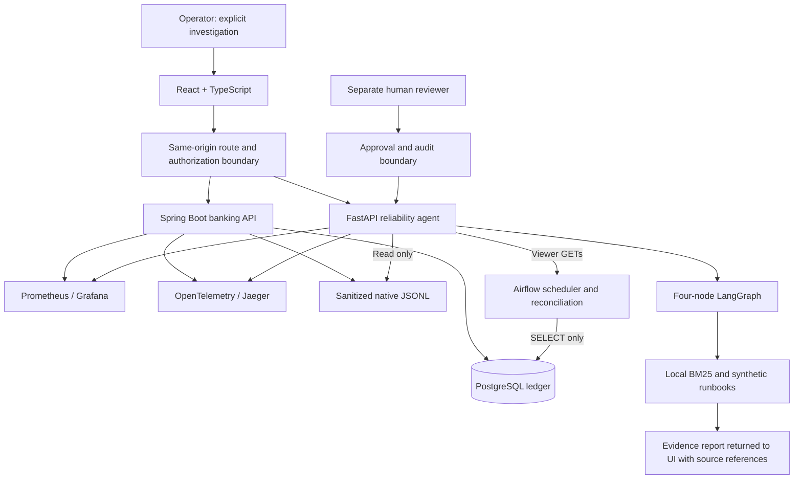

# BankOps AI

**Banking integrity, observability and evidence-grounded incident investigation.**

BankOps AI combines a transactional Java banking service, PostgreSQL ledger,
read-only Airflow reconciliation, a Python reliability agent and a React operations
workspace. It connects service symptoms to bounded metrics, traces, logs and
reconciliation evidence while keeping financial writes and human authorization
in separate components.


*Static interface preview from a browser test using no service requests or customer data.*

## Implemented capabilities

- **Banking integrity:** transactional transfers, double-entry ledger invariants,
  rollback, idempotency, concurrency control and database authorization tests.
- **Operational evidence:** Prometheus metrics, Grafana dashboards, OpenTelemetry
  traces through Jaeger and bounded, sanitized native JSONL log collection.
- **Incident investigation:** deterministic detection and a four-node LangGraph
  for collection, report assembly, local retrieval and optional hypothesis analysis.
- **Grounded analysis:** BM25 retrieval over reviewed synthetic runbooks, stable
  source references, locally validated evidence citations and an expandable citation viewer.
- **Reconciliation:** a scheduled Airflow DAG checks ledger/account invariants
  through a SELECT-only database role and exposes bounded task/check summaries.
- **Human governance:** separate proposer/reviewer roles, explicit confirmations,
  persistent audit records and gated execution of two read-only verification actions.

## Architecture and design decisions



Financial writes pass through Spring Boot and PostgreSQL integrity controls.
The agent collects operational evidence through bounded read interfaces, without
financial database credentials. The same-origin proxy restricts routes, methods
and origins and keeps service credentials on the server.

Detection and evidence remain authoritative when optional model analysis fails.
Local retrieval supplies traceable runbook references; hypothesis validation checks
both current observations and cited sources. External inference uses a separate
synthetic-data profile. See [architecture and evidence boundaries](docs/ARCHITECTURE.md).

## Integration evidence

The [scheduled reconciliation integration](docs/verification/STEP75_INTEGRATION_REPORT.md)
ran an actual Airflow scheduler against a disposable Compose environment. A
controlled read-permission fault produced an evidence-gap result that reached the
agent, LangGraph, local RAG and React dashboard through actual APIs in desktop and
mobile-sized Chromium. Investigation was explicitly initiated by the operator.

That dated integration record includes **544 passing agent tests** (two opt-in
browser cases skipped), **62 focused frontend tests** and **7 focused Java tests**.
[Hosted CI for published baseline `36a88e8`](docs/verification/HOSTED_36A88E8.md)
subsequently passed all four application jobs. These records distinguish component
regressions, synthetic browser fixtures and scheduler integration.

## Technology stack

| Area | Technologies |
| --- | --- |
| Banking | Java 21, Spring Boot, PostgreSQL, Flyway |
| Reliability | Python 3.12, FastAPI, LangGraph, Pydantic, httpx2 |
| Retrieval | Local BM25, JSON documents, content-addressed references |
| Workflows | Apache Airflow, read-only aggregate reconciliation |
| Dashboard | React, TypeScript, Vite, Playwright/Chromium |
| Observability | Prometheus, Grafana, OpenTelemetry, Jaeger |
| Delivery checks | Docker Compose, GitHub Actions, Trivy, SBOM artifacts |

Dependency versions are pinned in the repository lockfiles and Dockerfiles.

## Run locally

Prerequisites: Git, Python **3.12** and Docker Desktop/Engine with Compose 2.24.4+.
Host-side development tests also use Java 21 and Node 22.

```bash
git clone https://github.com/Bharathraj009/bankops-ai.git
cd bankops-ai
python3.12 local/platform.py up
python3.12 local/platform.py health
```

On Windows, use `py -3.12` in place of `python3.12`. Cold builds and Airflow
startup can take several minutes. The launcher generates ignored local credentials
and preserves existing networks and volumes. The default stack runs without a
cloud model or paid API; use a local synthetic-data environment.

| Local service | URL |
| --- | --- |
| Operations workspace | http://127.0.0.1:15173 |
| Airflow | http://127.0.0.1:18087 |
| Prometheus | http://127.0.0.1:19097 |
| Grafana | http://127.0.0.1:13007 |
| Jaeger | http://127.0.0.1:16687 |

Banking, agent and database ports are not published directly. Read ignored
`local/.env.local` locally for your generated credentials; never paste it into
issues, screenshots or logs. Stop without deleting persistent volumes:

```bash
python3.12 local/platform.py stop
```

After source changes, explicitly build the affected images before startup.
Airflow evidence and native log ingestion require additional configuration; the
[scheduled integration fixture](docs/verification/STEP75_INTEGRATION_REPORT.md)
uses viewer credentials, a trusted TLS CA and a read-only log mount. See the
[local runbook](local/README.md) and [RAG configuration](agent/RAG.md).

## Test and verify

Run tests against disposable databases and synthetic records, with test DSNs
separate from retained development or production data.

```bash
# Python agent: run from repository root, with Python 3.12
python3.12 -m venv agent/.venv
# Activate the environment using your shell's normal activation command.
python -m pip install pip==26.2.2 setuptools==84.2.1
python -m pip install -r agent/requirements-test.lock
python -m pip install --no-deps --no-build-isolation -e agent
cd agent
python -m pytest -q -W error -p no:cacheprovider
cd ..

# React: Node 22
cd frontend
npm ci
npm run lint
npm run format:check
npm run typecheck
npm test
npm run build
npx playwright install chromium
npm run test:e2e
```

Java and Airflow/database tests require disposable PostgreSQL instances; GitHub
CI provisions them per job. The [testing guide](docs/TESTING.md) and [CI guide](CI.md)
provide commands, database boundaries and the platform/image prerequisites for
the separate scheduler integration harness.

## Deployment scope and limitations

- **Deployment:** verified in local/disposable environments. Production deployment,
  SSO, operational TLS, log rotation and credential lifecycle management require
  additional engineering; Vite currently serves the local preview/proxy.
- **Model inference and data:** tests use synthetic data and mocked cloud inference.
  Successful live cloud inference remains unverified. External inference requires
  explicit synthetic-profile opt-in; operational banking evidence is blocked from
  export. Inference and remediation are disabled by default.
- **Automation:** investigations require an explicit request. Approvals and the two
  supported read-only actions are separately gated; service restart, scaling and
  autonomous banking remediation are outside the implemented execution path.
- **Evidence coverage:** idle traffic can leave metrics incomplete. A reconciliation
  evidence gap differs from financial corruption, and retrieved similarity does
  not establish causality. The quick start needs additional configuration for the
  complete scheduled-evidence/log path described above.
- **Image security:** baseline `36a88e8` has **44 unique HIGH package findings across
  eight CVEs, zero CRITICAL, and five blocked image gates**. Banking and Jaeger
  passed. [Per-image results](docs/verification/HOSTED_36A88E8.md) remain visible;
  strict HIGH/CRITICAL gates include unfixed findings.

See [security controls and history](SECURITY.md) and [public repository scope](PUBLICATION.md).

## Repository map

- `backend/banking-service/` — banking API, invariants and authorization tests
- `agent/` — evidence collectors, LangGraph, RAG, provider adapter and tests
- `airflow/` — reconciliation tasks, DAG and read-only database verification
- `frontend/` — operations UI, strict report parsing and browser tests
- `database/` — role provisioning, permissions and migration/security checks
- `monitoring/` — Prometheus/Grafana configuration and dashboards
- `local/` — guarded development launcher and disposable integration harnesses
- `.github/` — tests, image builds, SBOM/scanning and CI safety contracts
- `security/` — security controls, assessments and dated findings
- `docs/` — architecture, testing, screenshots and dated verification records
- `backups/` - historical verification source only; see [safety notes](backups/README.md)
