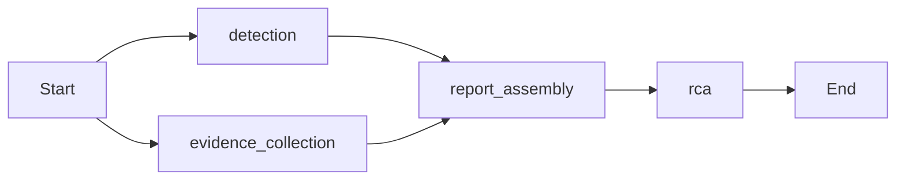

# Step 73: final end-to-end integration and AI verification

Verification date: October 29, 2026 (America/Chicago).

## Result and scope

This is an actual local verification of the current development source and nine
retained development services, plus fresh disposable financial/security fixtures.
No development banking records were changed. The development financial snapshot
and Flyway V1-V6 hashes match their pre-test values. All existing development
services remain healthy. No paid API, external AI inference, push or deployment
occurred, and no Docker volume was deleted.

The isolated platform uses previously verified banking/agent/frontend/database
images from Step 71B, the final patched Airflow image, and the Step 72C Jaeger
image. It has independent credentials, networks, metadata, financial records and
approval storage. The original development stack retains its own older images;
running a successful isolated fixture does not update that stack. No image rebuild
or dependency migration was needed for this step.

The existing guarded Step 66 security harness and Step 68 fixture allocator were
reused. Their historical prefixes in private fixture names identify the allocator,
not reused development databases. All financial writes targeted newly created
databases/containers; every controlled outage targeted the new fixture project.

## Passed and incomplete scenarios

| Scenario | Actual result |
| --- | --- |
| development baseline | PASS |
| banking regressions | PASS |
| airflow database regressions | PASS |
| agent regressions | PASS |
| launcher security ci regressions | PASS |
| frontend regressions | PASS |
| isolated api security | PASS |
| isolated platform startup | PASS |
| isolated banking rollback idempotency | PASS |
| actual dashboard chromium | PASS |
| isolated banking concurrency | PASS |
| isolated database outage rollback | PASS |
| controlled banking incident | PASS |
| langgraph disabled | PASS |
| langgraph mocked | PASS |
| langgraph adversarial | PASS |
| incident recovery | PASS |
| real airflow dag | PASS |
| airflow readonly and rbac | PASS |
| actual approval safeguards | PASS |
| isolated observability final | PASS |
| final safety | PASS |

Regression counts from the completed logs:

```json
{
  "agent": 487,
  "airflow_database": 59,
  "launcher_security_ci": 72,
  "frontend_components": 104,
  "chromium": 32,
  "banking": {
    "tests": 219,
    "failures": 0,
    "errors": 0,
    "skipped": 0
  },
  "live_security_chromium": 2,
  "actual_dashboard_browser_projects": 2
}
```

Banking checks include real HTTP transfers, matching-key replay, conflicting-key
rejection, insufficient-funds rollback, concurrent identical requests producing
one creation and one replay, balanced debit/credit postings, and reconciliation.
The full Java suite also exercises concurrent transfers, lifecycle invariants,
rollback, dedicated migration identity and authorization/ACL failures. The extra
security fixture tests customer registration/login, ownership/IDOR, cross-customer
debits, malformed/expired/revoked credentials, real HTTP concurrency and browser
credential isolation. These are synthetic records, not a production dataset.

The nine-service fixture's database outage produced failed reads, then recovered
with an unchanged financial snapshot. A separate fixture banking-service outage
was observed through actual Prometheus scrapes and triggered the actual agent's
banking_unavailable rule. The fixture recovered without financial duplication.

Grafana health, its real provisioned Prometheus datasource and dashboard API were
checked. Real banking requests produced ECS stdout events and OTLP traces, which
were queried through Jaeger and consumed by the actual agent collectors. Desktop
and mobile Chromium exercised the real fixture banking balance, monitoring and
dashboard routes. Separate standard Chromium tests exercise synthetic UI/API
fixtures; these are distinguished from the real-service browser checks.

## LangGraph execution

The installed graph was executed against live fixture evidence in each recorded
mode. The first two nodes run in parallel and join before report assembly:



Actual state writes are decision; traces/logs; report; and rca, respectively.
Each node executes once per graph invocation. The graph has bounded recursion,
no persistence/checkpointer configured, disabled LangSmith tracing and no action
execution node. The RCA result never asserts a confirmed root cause.

```json
{
  "mode": "disabled",
  "langgraph_version": "1.2.15",
  "graph_nodes": [
    "__end__",
    "__start__",
    "detection",
    "evidence_collection",
    "rca",
    "report_assembly"
  ],
  "graph_edges": [
    {
      "source": "__start__",
      "target": "detection"
    },
    {
      "source": "__start__",
      "target": "evidence_collection"
    },
    {
      "source": "detection",
      "target": "report_assembly"
    },
    {
      "source": "evidence_collection",
      "target": "report_assembly"
    },
    {
      "source": "report_assembly",
      "target": "rca"
    },
    {
      "source": "rca",
      "target": "__end__"
    }
  ],
  "updates": [
    {
      "node": "detection",
      "state_fields_written": [
        "decision"
      ]
    },
    {
      "node": "evidence_collection",
      "state_fields_written": [
        "logs",
        "traces"
      ]
    },
    {
      "node": "report_assembly",
      "state_fields_written": [
        "report"
      ]
    },
    {
      "node": "rca",
      "state_fields_written": [
        "rca"
      ]
    }
  ],
  "detection_state": "incident",
  "triggered_rules": [
    "banking_unavailable"
  ],
  "evidence_status": "partial",
  "trace_count": 10,
  "log_status": "missing",
  "log_events": 0,
  "native_log_trace_matches": 7,
  "rca_status": "undetermined",
  "rca_reason": "disabled",
  "root_cause_confirmed": false,
  "provider_calls": [],
  "real_model_inference": false,
  "external_ai_requests": 0
}
```

```json
{
  "mode": "mocked",
  "langgraph_version": "1.2.15",
  "graph_nodes": [
    "__end__",
    "__start__",
    "detection",
    "evidence_collection",
    "rca",
    "report_assembly"
  ],
  "graph_edges": [
    {
      "source": "__start__",
      "target": "detection"
    },
    {
      "source": "__start__",
      "target": "evidence_collection"
    },
    {
      "source": "detection",
      "target": "report_assembly"
    },
    {
      "source": "evidence_collection",
      "target": "report_assembly"
    },
    {
      "source": "report_assembly",
      "target": "rca"
    },
    {
      "source": "rca",
      "target": "__end__"
    }
  ],
  "updates": [
    {
      "node": "detection",
      "state_fields_written": [
        "decision"
      ]
    },
    {
      "node": "evidence_collection",
      "state_fields_written": [
        "logs",
        "traces"
      ]
    },
    {
      "node": "report_assembly",
      "state_fields_written": [
        "report"
      ]
    },
    {
      "node": "rca",
      "state_fields_written": [
        "rca"
      ]
    }
  ],
  "detection_state": "incident",
  "triggered_rules": [
    "banking_unavailable"
  ],
  "evidence_status": "partial",
  "trace_count": 10,
  "log_status": "missing",
  "log_events": 0,
  "native_log_trace_matches": 7,
  "rca_status": "hypotheses",
  "rca_reason": "supported_hypotheses",
  "root_cause_confirmed": false,
  "provider_calls": [
    {
      "context_bytes": 289,
      "context_sources": [
        "rule"
      ],
      "context_reference_ids": [
        "rule.banking_unavailable"
      ],
      "json_schema_requested": true
    }
  ],
  "real_model_inference": false,
  "external_ai_requests": 0
}
```

```json
{
  "mode": "adversarial",
  "langgraph_version": "1.2.15",
  "graph_nodes": [
    "__end__",
    "__start__",
    "detection",
    "evidence_collection",
    "rca",
    "report_assembly"
  ],
  "graph_edges": [
    {
      "source": "__start__",
      "target": "detection"
    },
    {
      "source": "__start__",
      "target": "evidence_collection"
    },
    {
      "source": "detection",
      "target": "report_assembly"
    },
    {
      "source": "evidence_collection",
      "target": "report_assembly"
    },
    {
      "source": "report_assembly",
      "target": "rca"
    },
    {
      "source": "rca",
      "target": "__end__"
    }
  ],
  "updates": [
    {
      "node": "detection",
      "state_fields_written": [
        "decision"
      ]
    },
    {
      "node": "evidence_collection",
      "state_fields_written": [
        "logs",
        "traces"
      ]
    },
    {
      "node": "report_assembly",
      "state_fields_written": [
        "report"
      ]
    },
    {
      "node": "rca",
      "state_fields_written": [
        "rca"
      ]
    }
  ],
  "detection_state": "incident",
  "triggered_rules": [
    "banking_unavailable"
  ],
  "evidence_status": "partial",
  "trace_count": 10,
  "log_status": "missing",
  "log_events": 0,
  "native_log_trace_matches": 7,
  "rca_status": "undetermined",
  "rca_reason": "invalid_output",
  "root_cause_confirmed": false,
  "provider_calls": [
    {
      "context_bytes": 289,
      "context_sources": [
        "rule"
      ],
      "context_reference_ids": [
        "rule.banking_unavailable"
      ],
      "json_schema_requested": true
    }
  ],
  "real_model_inference": false,
  "external_ai_requests": 0
}
```

The disabled-provider run exercises actual graph orchestration without inference.
The mocked run exercises the actual OpenAI-compatible HTTP adapter against a
loopback-only deterministic fake completion server. Its rule/span/log reference
IDs come from live collected evidence. The adversarial run returns an invented
reference and verifies rejection as invalid_output. Only completion generation is
simulated; the graph, collectors, context builder and output validator execute.

## RAG implementation status

Live evidence retrieval is implemented: fixed Prometheus queries, Jaeger v3
queries, bounded local JSONL reading and optional read-only Airflow collection.
`rca.analysis.evidence_catalog` builds bounded rule/span/log observations and IDs;
`RCAAnalyzer` constructs context, limits serialized input/output and validates
hypothesis kinds, evidence references, uncertainty and allowed investigation steps.
Source references identify observations, not documents or confirmed causes.

There is **no implemented document/vector RAG pipeline** in the inspected runtime
source/dependencies: no corpus ingestion, chunking, embedding model, vector index,
semantic retriever, reranker or document citation chain. Evidence-grounded RCA
must not be presented as completed knowledge-base RAG. No new RAG functionality
was added or represented as tested. A future RAG roadmap is not inferred from
the presence of LangGraph.

## LLM execution status

The retained development configuration has LLM_PROVIDER=disabled, no configured
LLM endpoint, disabled remediation and disabled agent Airflow integration. The
provider factory supports json_http and openai_compatible adapters; invocation
runs from the graph's rca node through RCAAnalyzer and the configured provider.
The standalone Groq verification helper has a mocked default and explicit live
opt-in; that opt-in was not enabled here. The Ollama example is preparation only.

Local Ollama at 127.0.0.1:11434 was unavailable during inspection. No model was
installed or downloaded and no paid/external API was called. **Real model inference
is not operationally verified and is unavailable in the checked development
configuration.** Mocked completions prove transport/context/validation mechanics,
not model reasoning quality, provider credentials, model availability or accuracy.

| Capability | Classification |
| --- | --- |
| Banking, ledger, HTTP authorization and atomic transactions | Implemented; real isolated verification |
| Prometheus detection, Jaeger evidence and LangGraph orchestration | Implemented; real isolated verification |
| Evidence context/catalog and source-ID grounding validation | Implemented; tested with live evidence and simulated completions |
| OpenAI-compatible/json HTTP provider path | Implemented; loopback mock invocation verified |
| Real LLM inference in retained development stack | Disabled; no operational real-model verification |
| Vector/document RAG | Not implemented in inspected runtime |
| Human proposal/reviewer separation and audit | Implemented; actual fixture API/browser verification |
| Autonomous financial remediation | Not enabled or exercised; no financial action executor |
| Restart/scale/dependency labels | Proposal types only; not executable banking remediation |

## Logs and evidence integration limitations

The retained Compose configuration does not wire a banking JSONL log source into
the agent. Step 73 used an explicitly documented fixture-only read-only mount and
manual export of real Docker stdout. No automatic production log shipper was
introduced. Banking's SafeEventLogger emits INFO even for failed outcomes, whereas
LogCollector accepts only WARN/ERROR. The native events and resulting collector
status are recorded above. Consequently, empty/not-configured log evidence and a
partial graph evidence status are honest integration gaps, not all-green evidence.
The harness did not relabel native events or fabricate errors to hide this gap.

One verification-harness attempt incorrectly expected proposal creation through
the dashboard proxy. That route is deliberately blocked. The harness was corrected
to use the trusted proposer API for creation and the UUID-scoped proxy for review.
Only remaining checks and corrected live dashboard routes were rerun in the same
Step 73-owned fixture; no application authorization policy was weakened.

## Approval, remediation, Airflow and security boundaries

Proposer and reviewer credentials are distinct. The actual fixture rejects
reviewer proposal creation and proposer approval, rejects repeated conflicting
decisions, and does not treat a banking token as an approval token. Approval
records intent only; execution remains disabled with HTTP 503. The implemented
execution allowlist is limited to CHECK_SERVICE_HEALTH and
REFRESH_INCIDENT_EVIDENCE, with no LLM-to-shell or financial-write action path.
Full agent tests also exercise those read-only actions against mocked evidence
services, persistence, audit/restart behavior and exactly-once claims. They do not
enable autonomous banking actions in the development or platform fixture.

The isolated Airflow scheduler executes the real four-task reconciliation DAG.
Its SELECT-only financial role remains denied writes even after requesting a
READ WRITE transaction. Viewer/config RBAC is tested. The DAG is paused again
after the manual run and the financial snapshot remains unchanged. Unit/database
tests and real scheduler execution are reported separately.

All earlier security limits remain: localhost publication is not production
TLS/authentication, operator/reviewer credentials are shared local identities,
customer APIs are disabled in the ordinary stack, no database RLS or production
customer identity is established, and privileged Docker/host administrators remain
trusted. Step 72C left 44 vendor-unfixed HIGH package findings across eight OS CVEs;
strict HIGH/CRITICAL gates remain blocking on five custom OS images. The patched
Jaeger image passes locally, but the retained development stack uses older images.
No production rollout, penetration-test certification or current scan of every
third-party image is claimed by this E2E run.

## Failed, disabled and unverified capabilities

- Native automatic log-to-agent integration is absent, and INFO-versus-WARN/ERROR
  filtering limits usable failure-log evidence.
- Real LLM inference is disabled/unavailable in the inspected environment.
- Document/vector RAG is not implemented.
- Production deployment, TLS/identity hardening and autonomous banking remediation
  were not enabled or tested.

All requested local verification stages completed; capability gaps above remain.

## Demo readiness and retained evidence

Suitable for a local synthetic banking/observability demo with explicit operator
credentials, real rule-based incident detection, trace evidence, real LangGraph
execution and manual approval boundaries. Clearly label the completion provider
as simulated; do not advertise operational generative AI, full RAG, automatic
failure-log ingestion or production readiness. Low traffic may correctly produce
insufficient_data. A healthy service is not proof of a healthy business workflow.

Raw synthetic responses, secrets, private run state and redacted logs remain in
ignored local/results and frontend/.cache fixture directories, never in this
report. Test fixtures are stopped and their newly created volumes preserved.
The original nine development services remain healthy, their financial snapshot
is unchanged, Flyway V1-V6 are unchanged and no push/deployment occurred.

Run evidence: `local/results/step73-a7bd81c1295c/report.json`.
