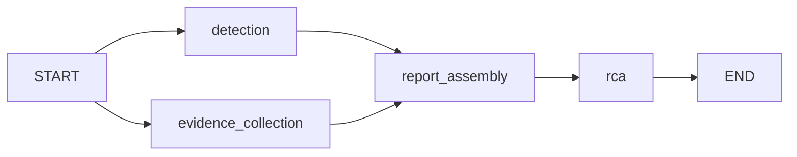

# LangGraph investigation workflow

`POST /workflows/investigate` runs a deterministic, read-only workflow and
returns HTTP 200 with the existing [InvestigationReport](INVESTIGATION.md) fields
plus an `rca` object; see [RCA.md](RCA.md) for optional inference configuration.
There is no request body or query configuration; either is rejected with
HTTP 400 before collecting evidence. The endpoint performs no financial writes.

```powershell
Invoke-RestMethod -Method Post http://localhost:8000/workflows/investigate
```

`GET /incidents/investigate` retains its existing contract and orchestration.
Both paths share collection helpers, detection rules, and report assembly.
Live executions may differ because evidence and timestamps change; identical
evidence and clocks produce identical investigation fields. Model-selected
hypotheses, when enabled, may vary; they never change those investigation fields.

## Architecture



The workflow uses LangGraph's typed `StateGraph` API and an explicit two-branch
join. See the [official graph API](https://docs.langchain.com/oss/python/langgraph/graph-api).

- `detection`: fetch the seven existing aggregate Prometheus observations and
  immediately evaluate the deterministic rules, preserving freshness checks.
- `evidence_collection`: concurrently fetch sanitized Jaeger traces and local
  log evidence with independent source fallbacks (WARN/ERROR by default;
  native INFO context is an explicit opt-in).
- `report_assembly`: after both branches finish, assemble the same report,
  counts, exact-ID groups and empty possible-explanations list as the GET path.
- `rca`: build a bounded evidence catalog, retrieve local runbook chunks when
  RAG is enabled, then run configured analysis and validate citations. Retrieval
  remains available with inference disabled; the RCA status is then undetermined.

`InvestigationState` is a `TypedDict` containing `started_at`, then optional
`decision`, `traces`, `logs`, `report` and `rca` fields populated by the nodes. Branches
write disjoint keys. The compiled graph is reusable, while each invocation gets
fresh ephemeral state. Collectors and settings remain in an application-owned
closure rather than graph input. Callers cannot inject state, sources, callbacks,
model prompts, paths, or workflow options. No conditional model routing exists.

## Failure and privacy behavior

The existing source statuses, bounded windows, payload/event/span limits,
allowlisted fields, exact-ID correlation, incident and insufficient-data rules
remain unchanged. One unavailable source does not stop other evidence from
returning. All-source failure returns an insufficient-data report, never a
healthy conclusion. Collection completeness remains separate from incident
status. No root cause is inferred.

Source deadlines are shared with the GET implementation. Parent cancellation
propagates. An unexpected graph execution or assembly error produces HTTP 503
with only `{"detail":"Investigation workflow unavailable"}` and the normal
correlation header; raw exception text and graph state are not returned/logged.
Invalid caller parameters receive HTTP 400; unsupported methods HTTP 405.

The graph has no checkpointer, persistence store, retry policy, background task
or remediation node. Its optional inference node is disabled by default.
LangSmith is a transitive
LangGraph dependency and an explicit dependency here solely for its local
`tracing_context(enabled=False)` guard. Workflow execution overrides ambient
LangSmith tracing and passes no callbacks, preventing evidence export even if
`LANGSMITH_TRACING` is enabled externally. The API returns the report only, not
graph updates or execution internals. Normal agent correlation logging remains
unchanged and contains no evidence bodies.

## Dependencies and execution

Python 3.12 dependencies are declared in `pyproject.toml` and fully pinned in
`requirements.lock` / `requirements-test.lock`. This implementation resolves
LangGraph **1.2.15** and LangSmith **0.14.9**. No model package or API key is
needed. Install and run using the existing [README](README.md) instructions.

Tests cover explicit branch/join transitions, one collection per source, report
parity across healthy/incident/partial/failure scenarios, privacy, exact-ID
grouping, deadlines, cancellation, concurrent invocations, disabled tracing,
caller-input rejection and safe graph failure. HTTP integration exercises the
actual collectors with mocked HTTP transports and temporary JSONL files through
both the original GET endpoint and the workflow POST endpoint.

## Verification

October 15, 2026: **227 agent tests passed** on Python 3.12 with warnings
treated as errors. Dependency validation reported no broken requirements.
The banking suite passed **202 tests**, with zero failures, errors or skips,
against disposable PostgreSQL 17. That container was removed afterward.
V1–V5 hashes match the previous baseline. Banking code, Compose, monitoring
configuration, and development services remain unchanged.
