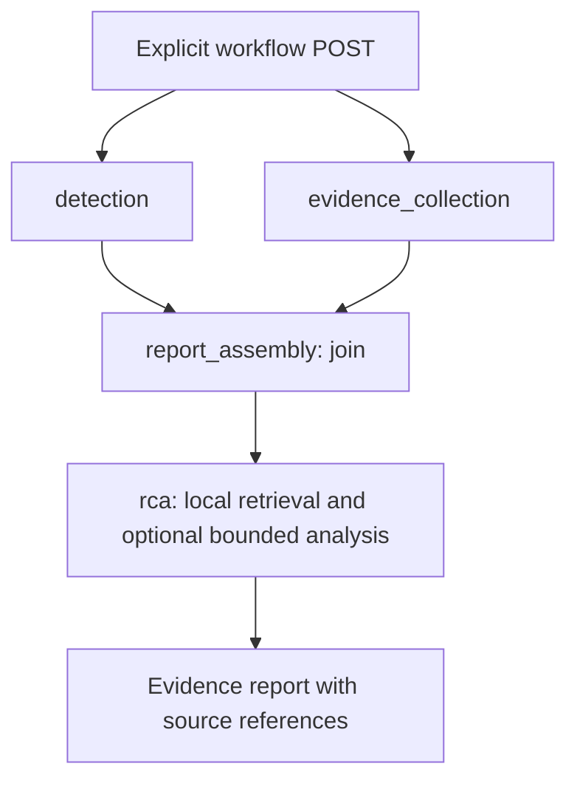
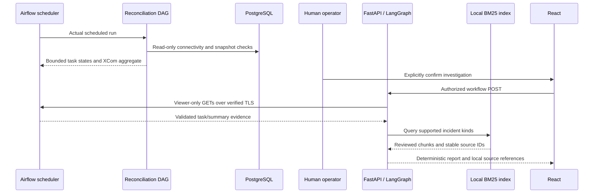

# Architecture and evidence boundaries

The operations dashboard calls a same-origin proxy. That proxy restricts routes,
methods and origins and supplies the server-held agent credential only to approved
agent routes. Financial operations remain in the banking API and PostgreSQL.
The agent has no financial database credentials or financial network membership.

## Real investigation graph

Detection uses validated metrics and optional bounded Airflow summaries. Supporting
evidence is collected from Jaeger and trusted local JSONL. Only safe identifiers,
timestamps, enums and aggregate fields enter reports; arbitrary upstream text is
not trusted as instructions. INFO log context is an explicit opt-in and never
becomes warning/causal evidence.

## Scheduled reconciliation to UI

The scheduled integration fixture temporarily restricted the reader's
schema-history
SELECT permission. Connectivity succeeded; reconciliation returned unavailable
evidence; validators failed intentionally. No banking records were changed.
The scheduled run, not a fabricated API response, reached Chromium. Initiation
of investigation remained manual and pull-based. See the [dated integration report](verification/STEP75_INTEGRATION_REPORT.md).

## Optional model path

Cloud inference is disabled by default. The supported adapter was exercised with
mocked transports; real inference is not claimed. External requests require a
separate synthetic-demo profile, explicit opt-in and canonical reviewed context.
Operational Airflow/banking evidence is blocked from export. Invalid, missing or
unsupported citations are rejected locally, independently of provider schemas.
Model output cannot propose arbitrary commands or directly write banking data.

Human approval uses distinct proposer/reviewer roles and explicit confirmation.
An approved record does not establish incident resolution. Execution and verification
have separate audit boundaries; the default runtime has remediation disabled.
